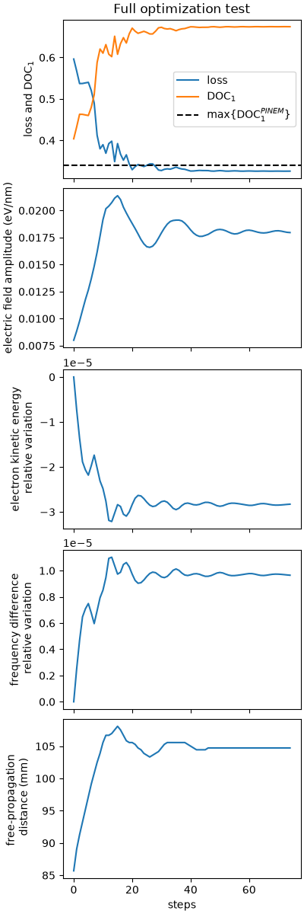
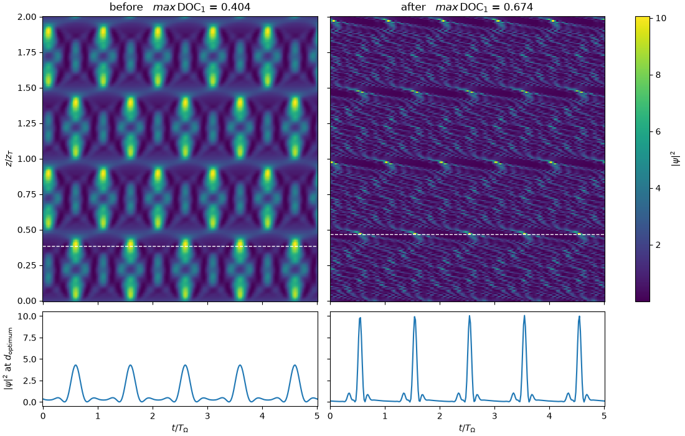

## ponderomotive

**Differentiable simulation of free-electron modulation by counter-propagating CW laser beams.**

A PyTorch `nn.Module` that propagates an electron incident electron with a well-defined 
energy through the interaction with two counter-propagating Gaussian beams, which puts 
the electron into a coherent superposition of different energy-states that correspond to 
the electron having exchanged photons with the laser beams, and the subsequent free-space 
propagation, where the drift between these energy components results in a position- and 
time-dependent interference pattern that can bunch the electron probability density into 
a train of compressed pulses. 

The segmented matrix-exponential propagation is an autograd graph end-to-end, so the physical 
parameters: field amplitude, electron kinetic energy (entering through the velocity `v`) , 
frequency difference between the lasers (`w1` and `w2`) and free-propagation distance, are 
trained by gradient descent against a coherence objective, rather than scanned by hand.

Based on C. I. Velasco and F. J. García de Abajo's, *Free-Space Optical Modulation of Free 
Electrons in the Continuous-Wave Regime*, [PRL **134**, 123804 (2025)]
(https://journals.aps.org/prl/abstract/10.1103/PhysRevLett.134.123804).

## Why

Temporal compression of free electrons has applications in quantum optics and ultrafast physics. 
The compression achievable in this scheme depends on four physical parameters at once. Making the 
interaction and the subsequent propagation differentiable turns the search into a training problem, 
with every parameter carrying a gradient of the compression metric.

## Scope

This project was a PyTorch exercise built on a physics problem I already knew well (the model 
reproduces the PRL above, which came out of my PhD work). Using a system I already understood 
well allowed me to sanity check every intermediate result with well-established benchmarks that 
I already understood (see `pinem_limit_test.py` for an example). This, in turn, let me build 
intuition for differentiable graphs, gradient-descent optimization and `nn.Module` on ground I 
could verify. The goal was to implement a known physical result as a differentiable graph and 
optimize through it, not to improve on the published treatment.

## What came out of it

Two things that were not obvious when I began the project had a real impact on the final shape of the
code.

**The parameters are badly conditioned against each other.** Since here we are dealing with physical 
parameters we have a problem related to units. In the atomic units used, the order of magnitude of 
each quantity is very different, which at first pushed me to do a log parametrization of the trainable
parameters. Even then, no single Adam learning rate works for all four because the frequency 
difference between laser beams and the kinetic energy of the electron enter through the 
phase-matching condition `v/c = (w1-w2)/(w1+w2)$` without which the electron--light interaction 
does not occur. The fix is a frozen conditioning width per parameter, derived analytically from 
the resonance width, so that one latent unit is one resonance width everywhere (`physics.py`). 
The finite-difference sweep in `gradient_test.py` verifies this, showing that a single `epsilon` 
validates all four gradients.

**Gradient descent is the wrong tool for the drift distance.** For the realistic parameters, the 
free propagation of the electron after interaction is a periodic in the free-propagation distance, 
so the metric used to evaluate compression presents periodic revivals. What's more, inside of each 
propagation period, this function presents several local maxima. Descent lands on whichever is 
nearest, and then skews the remaining parameters to suit it. A sweep over this distance instead
reports the true maximum for each combination of the interaction parameters. The sweep is nearly
free because the interaction does not depend on the distance, so the matrix-exponential propagation
through the interaction region is computed once and only a phase factor is swept. The final 
implementation is thus a hybrid: sweep the distance, and use descent on the rest 
(`optimize(..., profile = True)`).

## Result

The compression is measured by the degree of coherence `DOC_1` (see `metric.py`), which is 0 for 
a uniformly spread electron and 1 for a point-like one. The analytic reference is the non-recoil 
PINEM limit, `DOC_1≈ 0.34`, recoil effects included in our description allow this scheme to exceed it.

|| DOC_1 |
|---|---|
| Analytic non-recoil PINEM limit | 0.34 |
| Initial guess, drift distance optimized | 0.40 |
| Joint optimizatino of all four parameters | 0.67 |

`scan_latent` confirms this is a local optimum: `DOC_1` does not improve within a few conditioning
widths of the converged point along any latent. Higher compression is reachable at stronger coupling,
which this implementation does not explore (see Limitations).

## The physics

Full derivations are in the PRL. This section covers what is needed to read the
code. All internal quantities are in atomic units (`hbar = m_e = e = 1`),
conversion happens only at the input and output boundaries.

### Setup

An electron travels along the common optical axis of two counter-propagating
Gaussian beams of frequencies `w1 > w2` (enforced by construction, the sign of
`fr_diff` is forced negative in `physics.py`). Both beams are focused by the
same optics, so a single numerical aperture fixes the Rayleigh range
`zR = 2c / (w1 · NA^2)`, and their amplitudes are related by
`E2 = E1 · sqrt(w2/w1)`, which gives the two beams equal power. The incident
electron has a kinetic-energy spread much smaller than either photon energy, so
it is treated as monochromatic.

### The electron state

The state is an energy matrix `alpha[l1, l2]`, where `|alpha[l1,l2]|^2` is the
probability that the electron has exchanged `l1` photons with beam 1 and `l2`
with beam 2 (energy shift `l1·w1 + l2·w2`, with positive `l` for absorption).
The array is truncated at `|l1|, |l2| <= lmax`, with `lmax` set from the coupling
strength at initialization and then frozen. `edge_leakage` reports the
population sitting at the boundary, which is the diagnostic for whether that
truncation still holds.

### Stage 1 — interaction

The optical axis is sliced into segments and `alpha` is advanced by
`matrix_exp(-i·M(z)·dz)` on each. The generator `M` contains:

- **Diagonal.** Elastic processes that only provide a phase shift from each beam's own intensity,
  a linear term encoding the phase mismatch of each sideband, and a quadratic **recoil** term
  `(l1·w1 - l2·w2)^2 / (2·v·gamma^3·c^2)`.
- **Off-diagonal.** Two-photon couplings that raise or lower `l1` and `l2`. Of
  these, the difference-frequency term `b12` — one photon absorbed from one beam,
  one emitted into the other — is the one that provides the most relevant contributions.

**Phase matching** is what selects that term. On the anti-diagonal `l2 = -l1` the
linear part of the diagonal reduces to
`l1·[(1/v - 1/c)·w1 - (1/v + 1/c)·w2]`, which vanishes exactly when

```
v/c = (w1 - w2) / (w1 + w2)
```

so those sidebands accumulate no relative phase across the interaction region and
add coherently. Everything else oscillates and averages out, including the
single-beam terms, which is why **one beam alone produces no net modulation**.
The result is a ladder along `l2 = -l1`: the electron exchanges quanta of the
difference frequency `w1 - w2`.

Two numerical choices follow from the geometry. The interaction extent is set by
requiring the residual coupling at the edge to fall below `beta_target`, and the
axis is sampled as `z = zR·tan(theta)` on a uniform `theta` grid. This is a natural 
choice because the beam intensity falls as `1/(1 + (z/zR)^2) = cos^2(theta)` and the
Gouy phase is linear in `theta`. Both are frozen at construction, so the
autograd graph has a fixed shape. `convergence_test.py` sweeps them.

### The Gouy phase

Each beam carries `exp(i·arctan(z/zR))` through focus. Because both beams share
`zR`, this cancels in the couplings built from `E_i·E_i*` and from `E1·E2`, but
survives as `exp(2i·arctan(z/zR))` in those built from `E_i·E_i` and `E1·E2*`,
including the resonant `b12`. It is not a small correction: it advances by `pi`
across the focus and reshapes the coupling. It can be switched off
(`use_gouy=False`) to recover the pure PINEM limit for testing.

> **Note.** The treatment of the Gouy phase in the published PRL required an
> erratum. The main results of the paper are unaffected; this implementation
> follows the corrected treatment.

### Stage 2 — free propagation

After the beams, the sidebands drift. This is a pure phase applied elementwise —
populations are fixed, only relative phases evolve:

```
alpha[l1,l2] -> alpha[l1,l2] · exp(i · (l1·w1 + l2·w2)^2 / (2·v^3·gamma^3) · d)
```

which is quadratic in the sideband index, hence periodic: the natural scale is
the Talbot distance `zT = 4·pi·v^3·gamma^3 / (w1 - w2)^2`. Along the
anti-diagonal the phase is `2·pi·l1^2·d/zT`, so compression revives at
fractional multiples of `zT` — the several local maxima per period that motivate
sweeping this parameter rather than descending on it.

The phase is written in the electron's co-moving frame, which drops the ballistic
term linear in `l`. That term only translates the pulse train in time and does
not affect its duration, but keeping it would impose fast oscillations on the
optimization landscape.

### The objective

Compression is measured by the degree of coherence at order `m`,

```
DOC_m = |I_m / I_0|^2,    I_m = integral over one period of exp(i·m·W·t)·|psi(t)|^2 dt
```

with `W` the difference frequency by default. It is `0` for a uniformly spread
electron and `1` for a point-like one, and it measures how nearly a mode at
`m·W` sees the electron as a point particle. It is stricter than a peak width:
a slowly decaying background between pulses degrades `DOC_m` even when the peaks
themselves are narrow. `metric.py` evaluates it as a sinc-weighted double sum
over `alpha`, with the `alpha`-independent kernels cacheable across a sweep. 

## Installation

Requires Python 3.12 or newer.

```bash
git clone https://github.com/civelasco/ponderomotive.git
cd ponderomotive
python -m venv .venv
source .venv/bin/activate        # Windows: .venv\Scripts\activate
pip install -r requirements.txt
```

Or, with [uv](https://docs.astral.sh/uv/):

```bash
uv venv --python 3.12
uv pip install -r requirements.txt
```

Dependencies are `torch`, `numpy`, `scipy`, `matplotlib` and `jupyter`. CPU-only
PyTorch is sufficient — the simulation is a sequence of small dense matrix
exponentials in `complex128`, and there is nothing here that benefits from a GPU.

## Quickstart

Run from the repository root, the modules live in `src/`.

```python
import sys; sys.path.insert(0, 'src')

import torch
from physics import Config, ElectronModulator, interaction, free_propagation
from metric import degree_of_coherence
from optimize import profile_distance

# fixed discretization, frozen at construction (see convergence_test.py)
cfg = Config(frequency1=1.0,            # hbar*w1 in eV
             numerical_aperture=0.01,
             beta_target=1e-4,          # sets the interaction extent
             points_per_rayleigh=32)    # segment density

# physical parameters -- these are the trainable ones, given as initial guesses
model = ElectronModulator(cfg,
                          initial_kinetic=31e3,     # eV
                          initial_field=8e-3,       # eV/nm
                          initial_freq_diff=0.5,    # eV
                          initial_prop_dist=1.0,    # mm
                          use_gouy=True)
print(model)
# ElectronModulator(L=25, segments=99, beta0=1.23, v/c=0.333, intdist/zR=110.7)

# incident electron: no photons exchanged with either beam
alpha0 = torch.zeros((model.L, model.L), dtype=torch.complex128)
alpha0[model.lmax, model.lmax] = 1.0

with torch.no_grad():
    comb = interaction(model, alpha0)                    # ~1 min: the expensive step
    alpha = free_propagation(model, comb)                # drift by the initial 1 mm
    print(f"{degree_of_coherence(model, alpha, order=1).item():.4f}")
# 0.0807  -- 1 mm is nowhere near a revival

# the drift distance does not enter the interaction, so reuse the comb and
# sweep the distance instead: 200 trial distances for ~1% of one interaction
with torch.no_grad():
    prof = profile_distance(model, alpha0, n_z=200, alpha_int=comb)
print(f"DOC_1 = {prof.doc.item():.4f} at d = {prof.distance.item():.2f} mm")
# DOC_1 = 0.4046 at d = 85.69 mm
```

On a laptop CPU the interaction takes about a minute and the 200-point sweep that
follows it under a second, passing `alpha_int` is what buys that, since
`profile_distance` otherwise recomputes the interaction itself.

Note the numerical aperture. `NA = 0.01` keeps `zT/zR` small enough that recoil
remains significant; at `NA = 0.2` the recoil term is negligible and the Gouy
phase suppresses the modulation almost entirely. The tests in `src/` use the
wide-aperture setting deliberately, with `use_gouy=False`, to isolate the
analytic PINEM limit.

For the full workflow (gradient checks, the hybrid optimization, Talbot carpets
and the landscape scans) see [`example.ipynb`](example.ipynb).

## Repository structure

```
ponderomotive/
├── README.md
├── requirements.txt
├── example.ipynb          walkthrough: forward pass -> checks -> optimization
├── plots/                 figures written by the test scripts
└── src/
    ├── physics.py         ElectronModulator, interaction, free_propagation
    ├── metric.py          degree_of_coherence, cacheable sinc kernels
    ├── optimize.py        optimize, profile_distance, scan_latent
    ├── gradient_test.py   autograd vs finite differences
    ├── convergence_test.py   segment density and interaction extent
    └── pinem_limit_test.py   analytic PINEM limit, Gouy off
```

**The model.** `physics.py` holds the forward model: `Config` fixes the frozen
discretization, `ElectronModulator` is the `nn.Module` carrying the four
trainable parameters, and `interaction` / `free_propagation` are the two
propagation stages. `metric.py` is the objective. `optimize.py` sits on top of
both: `optimize` for gradient descent, `profile_distance` for the drift sweep,
`scan_latent` for mapping the landscape along one parameter.

**The tests** are standalone scripts rather than a `pytest` suite — each prints a
table and writes a figure to `plots/`. They check different things:
`gradient_test.py` that the graph is connected and the conditioning widths work,
`convergence_test.py` that the discretization is refined enough,
`pinem_limit_test.py` that the propagation reproduces a closed form.

### Running things

Everything runs from the repository root:

```bash
jupyter notebook example.ipynb
python src/gradient_test.py
python src/convergence_test.py
python src/pinem_limit_test.py
```

The test scripts anchor their output to `plots/` relative to their own location,
so they also run correctly from inside `src/`.

## Design decisions

### The forward model is an `nn.Module`

The interaction is a product of segment propagators,
`U = prod_n matrix_exp(-i·M(z_n)·dz_n)`, applied to a state vector. That is
structurally a deep network with fixed weights and trainable inputs, so making
it differentiable is a matter of building it out of autograd-tracked operations
rather than of writing any adjoint code. Gradients of the objective with respect
to field amplitude, kinetic energy, frequency difference and drift distance come
from `loss.backward()`.

Everything runs in `complex128`. The propagation is unitary and the objective is
a ratio of two nearly-cancelling sums, so single precision is not enough, and
the gradient check in `gradient_test.py` would be the first thing to fail if it
were.

### Two-layer parametrization: log scale, then conditioning width

The four parameters differ by many orders of magnitude in atomic units, so each
is carried as `value = scale · exp(width · latent)`, with `scale` and `width`
frozen buffers and `latent` the trainable `nn.Parameter`, initialized at zero.

`scale` is the user's own initial guess, which fixes the magnitude. `width`
fixes the *curvature*, which is the part a log parametrization alone does not
solve. The kinetic energy and the frequency difference enter through the
phase-matching resonance, so the loss varies over
`pm_width = pi·v / (|dw|·L_eff)` in those directions but over an e-fold in the
other two, four orders of magnitude apart. Each width is therefore derived
analytically at construction so that **one latent unit is one resonance width**,
after which a single Adam learning rate works for all four.

Two consequences worth knowing when reading the code:

- **Constraints come for free.** `exp` keeps the field, the energy and the
  distance positive without clamping, which would otherwise zero the gradient at
  the boundary. The sign of `fr_diff` is forced negative in the property, so
  `w2 < w1` holds by construction rather than by assertion.
- **The latents are the natural units for scans.** `scan_latent` takes latent
  values, so a scan of ±3 means ±3 resonance widths for the phase-matching
  parameters and ±3 e-folds for the others, which are comparable ranges without
  the caller having to know the physics.

Verified by `gradient_test.py`: a single finite-difference `eps` validates all
four gradients, which is only true if the conditioning worked. The script sweeps
`eps` over twelve decades and recovers the expected U-shaped error curve
(truncation `~eps^2` against round-off `~1/eps`).

### The discretization grid is frozen

`lmax`, the segment positions and the conditioning widths are all computed once,
under `no_grad`, from the initial parameters — and then never recomputed. This is
deliberate: if the grid tracked the parameters, tensor shapes would change
mid-optimization, and a scan point would mean a different physical detuning at
every step.

The cost is that the grid can go stale if the optimizer wanders far. That is what
`edge_leakage` is for — it reports the population at `|l| = lmax`, and `optimize`
warns above `1e-2`.

### `tan` sampling along the optical axis

The interaction region spans ~100 Rayleigh ranges, but the coupling falls as
`1/(1 + (z/zR)^2)`. Uniform sampling wastes segments in the tails. Substituting
`z = zR·tan(theta)` on a uniform `theta` grid makes the integrand
`cos^2(theta)` and the Gouy phase linear in `theta`, concentrating segments near
focus where the physics happens.

The trade-off is documented in `convergence_test.py`: since
`theta_max = arctan(intdist / 2·zR)` is bounded by `pi/2`, the segment count
saturates as `beta_target` shrinks while the physical extent keeps growing, so
the outermost segments eventually become under-resolved. Past that point the
analytic PINEM test is the more trustworthy check on the extent.

### Sweep the drift distance, descent on the rest

Along the anti-diagonal the drift phase is `2·pi·l1^2·d/zT` and gives several local
maxima of `DOC_m` per Talbot period. Descent finds the nearest one and then skews
the remaining parameters to suit it.

Sweeping is nearly free because the interaction does not depend on the distance:
the comb is computed once and only a phase factor is applied, so 200 trial
distances cost about 1% of one interaction. `optimize(..., profile=True)` does
this inside the training loop, sweeping to locate the maximizer under
`no_grad`, then re-evaluating once at the winning distance *with* the graph, so
the descent step still sees a gradient through `zT`.

The same argument makes `scan_latent` meaningful: `zT` depends on velocity and
frequency difference, so a scan at fixed distance would drift off its optimal
phase and report a decrease unrelated to the interaction. Profiling the distance
at every point makes the reported quantity `max_d DOC_m`, a function of the
interaction parameters alone.

### Caching where it is safe, and where it is not

`degree_of_coherence` builds `(L,L,L,L)` sinc kernels that depend only on the
frequencies, so `sinc_kernels` can be built once and reused across a sweep. But
those kernels depend on `freq2`, hence on `log_fr_diff`: kernels built under
`no_grad` are detached, and reusing them in a gradient-carrying evaluation would
silently drop that contribution. The code therefore reuses kernels inside the
`no_grad` sweep and deliberately rebuilds them for the single evaluation that
carries the graph.

`optimize` guards the analogous trap for `alpha_int`: passing a precomputed comb
while an interaction parameter still requires grad raises, rather than training
against a stale forward pass.

## Validation

The model is checked in three independent ways. Each would fail on a different
class of error, which is the point of having all three.

### The gradients are correct — `gradient_test.py`

Autograd is compared against a central finite difference on the same
discretization, so the check isolates the graph rather than the physics. Sweeping
the step `eps` over twelve decades recovers the expected U-shaped error curve:
truncation error falling as `eps^2`, round-off rising as `1/eps`, with a minimum
in between.

The informative part is that **a single `eps` works for all four parameters**.
Under a naive log parametrization the minima sit decades apart, because the loss
curves far more sharply along the phase-matching directions than the others; the
conditioning widths collapse that spread. The curve is therefore a test of the
parametrization, not only of the gradients.

`gradient_test(model, alpha0, eps=...)` is importable for a single check — that
is how `example.ipynb` uses it. Running the module directly produces the full
diagnostic curve and can take up to a couple of hours.

### The discretization is converged — `convergence_test.py`

Two knobs control the integration and converge to different limits, so each is
swept with the other fixed:

- `points_per_rayleigh`, the segment density
- `beta_target`, which sets how far from focus the interaction region extends

Convergence is measured on `DOC_1` — the quantity actually optimized — to a
tolerance of `1e-3`, and the script reports the *first plateau* rather than the
smallest change.

One limitation is documented rather than hidden. Since
`theta_max = arctan(intdist / 2·zR)` is bounded by `pi/2`, the segment count
saturates as `beta_target` shrinks while the physical extent keeps growing, so
the outermost segments become under-resolved and pushing `beta_target` too low
makes results worse rather than better. The extent sweep is meaningful only where
`nseg` still grows with `beta_target`; beyond that the analytic test below is the
better benchmark.

### The propagation is right — `pinem_limit_test.py`

Self-convergence only shows that results stop moving. This test checks they stop
at the correct value.

In the phase-matched non-recoil limit with the Gouy phase off, the interaction
reduces along the anti-diagonal `l2 = -l1` to a single PINEM ladder driven by the
difference-frequency term, with a closed form:

```
P_n = J_n(4·b12·pi·zR)^2
```

The script sets the electron energy to exact phase matching
(`v/c = (w1 - w2)/(w1 + w2)`, about 31 keV here), runs the interaction, and
compares the anti-diagonal populations to the Bessel functions term by term. It
also reports the off-anti-diagonal population and the recoil phase, both of
which must be small for the reduction to apply.

This is the strongest check in the repository: it exercises the
matrix-exponential propagation, the Hermiticity of the generator, the phase
matching and the coupling normalization simultaneously, against an answer that
does not come from this code.

### What is not covered

There is no test of the Gouy-phase regime against an independent result — while an
analytic result exists, it predicts no sideband creation and thus no changes to the
energy matrix after the interaction, which is why the analytic check runs with
`use_gouy=False`.

## Results

### Optimization



Starting from a hand-chosen guess, the hybrid scheme — drift distance swept, Adam
on the remaining three — raises `DOC_1` from 0.40 to 0.67, roughly twice the
non-recoil analytic limit of 0.34, in about 40 steps.

The parameter traces are the more interesting half of this figure. The kinetic
energy and the frequency difference move in opposite directions with the same
shape, tracking each other through parameter space: the optimizer is holding the
phase-matching condition while it improves the compression, which is not
something it was told to do.

### Compression



Electron probability density against time (horizontal) and drift distance
(vertical), a Talbot carpet. Bright spots are where and when the electron is
most likely to be found; the periodic revivals are the compression events, and
their spacing is set by the Talbot distance.

The lower panels compare the pulse train at the optimal distance before and after
optimization. The optimized parameters give narrower pulses on a lower background,
the second part being what `DOC_1` rewards and a peak-width measure would not.

### Landscape


`scan_latent` along each latent, with the drift distance profiled out at every
point so the reported quantity is `max_d DOC_1` — a function of the interaction
parameters alone. The converged point is a local maximum: no direction improves
within a few conditioning widths. Note the horizontal axis is in latent units,
where one unit is one resonance width for the kinetic energy and the frequency
difference and one e-fold for the field amplitude.

## Limitations

**Cost grows steeply with the coupling.** The generator is a dense `(L², L²)`
matrix with `L = 2·lmax + 1`, exponentiated once per segment, and `lmax` is set
linearly by the coupling `beta0 ∝ E²·zR`. The three configurations in this
repository span a wide range as a result:

| configuration | `L` | matrix dim | segments | relative cost |
|---|---|---|---|---|
| `example.ipynb` (NA=0.01, E=8e-3) | 25 | 625 | 99 | 1× |
| `convergence_test.py` (NA=0.2, E=0.15) | 21 | 441 | 397 | ~1.4× |
| stronger coupling, `beta0 ≈ 4` | 79 | 6241 | 399 | ~4000× |

The strong-field regime needed for high `DOC_1` is therefore out of practical
reach here. The generator is banded — the couplings shift `l1` and `l2` by at
most two — so a sparse or banded treatment is the natural next step.

**Aperture is constrained by physics, not only cost.** `zT/zR ∝ NA²`, so a wide
aperture makes recoil negligible and the Gouy phase suppresses the modulation
almost entirely. The working configurations sit at small `NA`.

**No batching.** The forward pass handles one parameter set at a time; a scan is
a Python loop. Vectorizing over a batch dimension would make the landscape maps
considerably cheaper.

## References

C. I. Velasco and F. J. García de Abajo, *Free-Space Optical Modulation of Free
Electrons in the Continuous-Wave Regime*, Phys. Rev. Lett. **134**, 123804
(2025). [DOI](https://doi.org/10.1103/PhysRevLett.134.123804)

```bibtex
@article{velasco2025freespace,
  title   = {Free-Space Optical Modulation of Free Electrons in the
             Continuous-Wave Regime},
  author  = {Velasco, C. I. and García de Abajo, F. J.},
  journal = {Phys. Rev. Lett.},
  volume  = {134},
  number  = {12},
  pages   = {123804},
  year    = {2025},
  doi     = {10.1103/PhysRevLett.134.123804}
}
```

## Citing this code

Cite the paper for the physics. If you use the implementation itself, please also
link this repository.

## License

[MIT](LICENSE)
